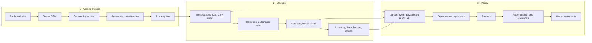

# PROJECT_MAP.md — ALVILLAS OS

The private operating and financial system of ALVILLAS SARL: villa management for third-party owners in Morocco. One platform, one data model, one permission system, four surfaces. 355 features across 14 phases. Independent web application (own repository, database, hosting, accounts).

## How the business flows

## Four surfaces, one source of truth
- **Admin (desktop):** Command Center, work views, properties, finance, variances, team, config rules, permission simulator, audit.
- **Owner portal:** own villas only: reservations, money held and paid, statements, approvals, condition, documents.
- **Guest Hub (signed link):** forms, house rules, agreement signature, services, chef menu, transfers. Structured self-service, no chat.
- **Field app (offline PWA):** phone + PIN, Today, checklists, linen and inventory +/−, photos, issues, proxy validation by supervisors.

## Rules that apply everywhere
Deny-by-default permissions · role ≠ data access · money ownership ≠ money location · balances derived from movements · append-only audit and ledger · rules are config, not code · EN + FR now, Arabic/RTL-ready · Expected → Actual → Variance → Action · 500+ villas from day one · no internal chat.

## Feature modules (individual IDs live in PROGRESS.md and the handbook)
| Module | Features | Phase | What it covers |
|---|---|---|---|
| Foundation | 16 | 0 | CI/CD, migrations, health, Sentry, outbox and jobs, provider fakes, first-admin bootstrap, live staging and production |
| Identity and login | 11 | 1 | Person separate from account, phone + PIN for field staff, invitations, passkey + MFA for admin and finance, recovery |
| Authorization | 12 | 1 | Deny-by-default, custom roles, scoped assignments, field-level masking, tenant isolation, permission simulator |
| Audit | 5 | 1 | Append-only who, what, when, where, before, after, reason for every sensitive action |
| Languages and design system | 17 | 1 | EN/FR now, Arabic/RTL-ready; five shells: admin, manager, owner, guest, field |
| Configuration engine | 8 | 2 | Versioned, effective-dated rules by scope; reservation snapshots; feature flags |
| Owners and properties | 11 | 2 | Operating profile, versioned management agreement, amendments, workspace tabs, lifecycle |
| Templates | 6 | 2 | Property, inventory, workflow, checklist and service templates with visible overrides |
| Team | 8 | 2 | Multiple scoped roles, pay per job, month or hour, availability, workload, documents |
| Reservations | 16 | 3 | iCal, CSV and Airbnb payout import, duplicates, double-booking, cancellations, guest records |
| Operations and tasks | 10 | 3 | Task states, checklists, assignment, Timeline/List/Day/Week/Month views, bulk actions, readiness |
| Automation | 7 | 3 | Event → rule → action, versioned, dry-run, idempotent; mid-stay clean after N nights |
| Field app | 20 | 4 | Offline queue and sync, conflict screen, photo upload, proxy validation, wallet, cash collection |
| Finance engine | 42 | 5 | Ledger, commission snapshots, expense treatments, approvals, wallets, payouts, reconciliation, closing |
| Documents and signatures | 11 | 6 | Versioned contracts, EN/FR PDFs, e-signature, archive, expiry reminders |
| Owner CRM | 8 | 6 | Lead pipeline from first contact to go-live, proposals, conversion without re-entry |
| Onboarding | 7 | 6 | 11-step wizard, activation workflow, bilingual owner package from real configuration |
| Guest Hub | 16 | 7 | Signed link, profile, ID capture, house rules, agreement, services, groceries, transfers |
| Services and chef | 8 | 7 | Catalog with owner/ALVILLAS shares, chef menu, ingredients, margin, compensation |
| Inventory | 10 | 8 | Movement ledger only, minimums, reorder suggestions, stocktakes, expected consumption |
| Laundry and linen | 9 | 8 | Batches, damaged vs missing, versioned price lists, expected vs actual invoice, variance |
| Maintenance and assets | 10 | 8 | Issues, work orders with approval, asset register, warranties, preventive schedules |
| Suppliers | 5 | 8 | Directory, price lists, payables, price-change alerts |
| Owner portal | 13 | 9 | Own villas only, statements, approvals center, money held, delegate access |
| Reports and KPIs | 9 | 10 | Occupancy, ADR, RevPAR, margins, owner net, variance rate; all from source data |
| Command Center | 6 | 10 | Today, exceptions, financial and operations panels, global search |
| Notifications | 8 | 1 / 10 | Email, in-app, push, WhatsApp links, digests, delivery log; no internal chat |
| Public website | 9 | 11 | Premium owner-acquisition site, Get a Property Assessment form into CRM, SEO |
| Personal OS | 11 | 12 | Separate family finance domain with per-member permissions and explicit transfers |
| Hardening and launch | 26 | 13 | Pen test, load tests at 500 villas, restore drills, data migration, pilot month, training |

## Architecture
Clients (Admin, Owner portal, Guest Hub, Field PWA) → Next.js app (locale routes /en /fr /ar → Zod validation → authorize()) → application services → domain (Money, ledger rules, state machines, config resolver, automation evaluator) → repositories (tenant-scoped, field masking) → PostgreSQL (organization_id + row-level security, append-only ledger and audit via triggers, outbox). Jobs via outbox → Inngest. Providers behind interfaces: email (Resend), storage (R2), signatures (Documenso), payments, reservation adapters, PDF. Operations: Sentry, structured logs, staging + production, PITR backups.

## The ledger in four lines
| Event | Debit | Credit |
|---|---|---|
| Direct booking 8,000 DH received | Bank 8,000 | Owner payable 8,000 |
| Commission 20% | Owner payable 1,600 | ALVILLAS commission 1,600 |
| Payout 4,000 DH | Owner payable 4,000 | Bank 4,000 |
| Wallet: advance 1,500, groceries 850, supplies 200 | Balance = 450 DH, derived from movements | |

## Build order (14 phases)
0 Foundation, live URL · 1 Identity, authz, audit, i18n, design system · 2 Core domain and config · 3 Reservations → operations · 4 Field app (offline) · 5 Financial engine · 6 Documents, CRM, onboarding · 7 Guest Hub, services, chef · 8 Inventory, laundry, maintenance, suppliers · 9 Owner portal · 10 Reports, KPIs, Command Center · 11 Public website · 12 Personal OS · 13 Hardening and launch.
